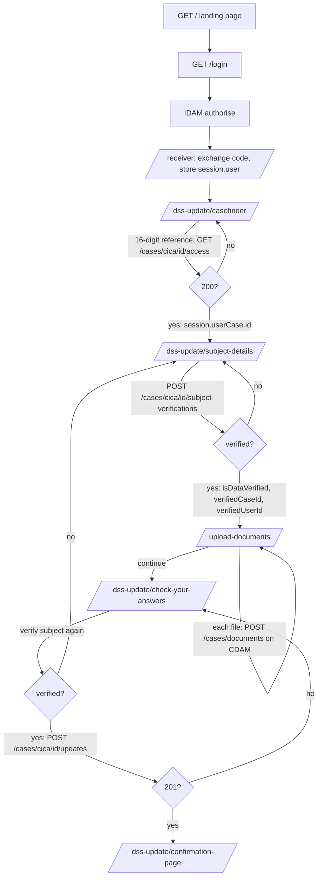

# Update-case journey

This page describes how `sptribs-dss-update-case-web` takes a citizen from sign-in to a submitted case update, which back-end calls it makes, and how sessions, Welsh and document uploads work.

## Overview

## Sign-in

The OIDC middleware (`src/main/modules/oidc/index.ts`) adds three routes:

| Route | Behaviour |
|---|---|
| `GET /login` | Redirects to IDAM `authorize` with the callback `/receiver` |
| `GET /receiver` | Exchanges the authorisation code for tokens, decodes the ID token into `session.user`, resets `session.userCase` and redirects to `/dss-update/casefinder` |
| `GET /logout` | Destroys the session and redirects to the IDAM end-session URL |

Every other route needs a signed-in user whose roles include `citizen`. The exceptions are the landing page and the pages listed in `signInNotRequired()` (`src/main/steps/url-utils.ts`): accessibility statement, contact us, cookies, privacy policy, terms and conditions, and timed out.

The landing page (`/`, `src/main/routes/authless/landing/get.ts`) redirects a signed-in user to the case finder. Otherwise it renders the start page, in Welsh when called with `?lang=cy`.

## Routing

Steps are defined in `dss_update_steps` (`src/main/steps/dss-update/dss-sequence.ts`) and in the upload step's own sequence (`src/main/steps/upload-documents/uploadDocumentsSequence.ts`). Each step is a directory holding `content.ts`, `template.njk` and, where needed, its own GET or POST controller.

`src/main/routes.ts` registers a GET route for every step and a POST route for every step with a form, using the step's own controller if the directory has one and the generic `GetController` or `PostController` otherwise. It also adds route guards:

| Route | Guard |
|---|---|
| `/dss-update/subject-details` | `requireSelectedCase`: `session.userCase.id` must be a 16-digit reference, or the user is sent to the case finder. POSTs are rate-limited to 10 per 15 minutes for each user and case |
| `/upload-documents`, `/dss-update/check-your-answers` | `requireVerifiedCase`: `session.isDataVerified` must be true, and `session.verifiedCaseId` and `session.verifiedUserId` must match the current case and user, or the user is sent to subject details |

## Steps and API calls

All case calls go to `sptribs-case-api` (`services.sptribs.url`, `CASE_API_URL`) through `src/main/app/case/api.ts`. Each call carries the user's IDAM token in `Authorization` and an S2S token in `ServiceAuthorization`.

### Case finder

`src/main/steps/dss-update/casefinder/postController.ts`:

1. Clears any earlier verification (`verifiedCaseId`, `verifiedUserId`, `isDataVerified`).
2. Checks the reference against `^\d{16}$`.
3. Calls `GET /cases/cica/{caseId}/access`. On 200 it sets `session.userCase = { id }` and goes to subject details. Any other result shows the `caseNotFound` error.

### Subject details

`src/main/steps/dss-update/subject-details/postController.ts`:

1. Clears any earlier verification.
2. Formats the date of birth as `YYYY-MM-DD`.
3. Calls `POST /cases/cica/{caseId}/subject-verifications` with `{ subject_full_name, subject_date_of_birth }`.
4. If the response has `verified: true`, sets `isDataVerified`, `verifiedCaseId` and `verifiedUserId` and goes to the upload page. Otherwise the page shows an error.

The name and date of birth stay in the session so that check your answers can verify them again.

### Upload documents

See [Document upload](#document-upload). The page collects any number of files, up to the limit, each with an optional description, and a free-text description of the update (`documentDetail`). Continue needs at least one file or some text.

### Check your answers

`src/main/steps/dss-update/check-your-answers/postController.ts`:

1. Sends the user back to subject details if the verification flags in the session do not match the case and user.
2. Calls the subject verification endpoint again with the stored name and date of birth. If that fails, it clears the flags and sends the user back to subject details.
3. Maps the uploaded documents in `session.caseDocuments` to `{ document_url, document_binary_url, document_filename, comment }`.
4. Calls `POST /cases/cica/{caseId}/updates` with `{ additional_information, documents }`. `sptribs-case-api` applies the `citizen-cic-dss-update-case` event to the case.
5. On 201 it goes to the confirmation page. Any other response shows a `submissionError`.

The update carries only document references. The file bytes have already been stored in CDAM.

### Confirmation

`/dss-update/confirmation-page` shows the result. Posting from it destroys the session and returns to `/`.

The `citizen-cic-dss-update-case` event and the endpoints above are defined in [sptribs-case-api](https://github.com/hmcts/sptribs-case-api). The event can be applied in any case state except `DSS_Expired`.

## Document upload

The upload page is a `multipart/form-data` form posted to the app, which forwards each file from the server:

1. `express-fileupload` (`src/main/modules/fileupload/index.ts`) parses the body into `req.files`. Its size limit is `documentManagement.uploadSizeinMB` (101 MB), just above the validation limit.
2. `src/main/steps/upload-documents/postController.ts` validates the file:
   - the extension must be one of `jpg`, `jpeg`, `bmp`, `png`, `pdf`, `doc`, `docx`, `rtf`, `xlsx`, `xls`, `txt`, `mp3` or `mp4`;
   - the size must not exceed `uploadPolicy.documentSize` (100 MiB);
   - no more than `uploadPolicy.maxNoOfFiles` (20) files can be uploaded;
   - the description must not contain Markdown links or disallowed characters.
3. `uploadDocument()` in `src/main/app/fileUpload/documentManager.ts` posts the file to CDAM `POST {services.cdam.url}/cases/documents` with `caseTypeId` and `jurisdictionId` from config, `classification: PUBLIC`, and `authorization`, `serviceAuthorization` and `user-id` headers.
4. The returned document URL, binary URL, file name and description are added to `session.caseDocuments`.

Removing a file (`/upload-documents?removeId=<id>`) calls `deleteDocument()`, which sends `DELETE /cases/documents/{id}` to CDAM, and removes it from the session.

## Sessions

Sessions use `express-session` (`src/main/modules/session/index.ts`):

| Setting | Value |
|---|---|
| Cookie name | `sptribs-dss-update-case-web-session` |
| Lifetime | `session.maxAge`, 1260000 ms (21 minutes), rolling |
| Flags | `httpOnly`, `sameSite: 'lax'` (needed for the IDAM redirect); `secure` outside development mode |
| Store | Redis (`connect-redis`, TLS, 15-second connect timeout) when `session.redis.host` is set; otherwise a file store in `/tmp` |

The session holds the signed-in user, the case reference, the verification flags, the subject's name and date of birth, the uploaded document references, the description and the language choice. When the session expires the citizen has to sign in and start again; documents already stored in CDAM are not attached to the case until the update is submitted.

In deployed environments this app uses the same Azure Cache for Redis instance as `sptribs-frontend`. The two apps use different cookie names, so their sessions are separate.

## Welsh

The app supports English and Welsh. `LanguageToggle` (`src/main/modules/i18n/index.ts`) reads `?lng=cy` or `?lng=en` on any GET request and stores the choice in `req.session['lang']`, where it stays until changed. Unsupported values are ignored, and the default is English.

Each step's `content.ts` exports an `en()` and a `cy()` function returning the page text and error messages. New content needs both.

## Related documentation

- [Configuration](configuration.md)
- [Running and testing](running-and-testing.md)
- [sptribs-case-api](https://github.com/hmcts/sptribs-case-api): the `/cases/cica/...` endpoints and the `citizen-cic-dss-update-case` event
- [sptribs-frontend](https://github.com/hmcts/sptribs-frontend): the new appeal journey and the citizen dashboard
